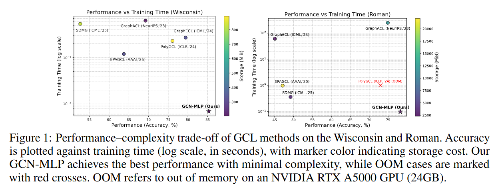

# BackToBasics-GCL

This repository contains the code for our NeurIPS 2026 accepted paper, \*Return to Basics: Very Simple Graph Contrastive Learning via Noise Cancellation Principle\*.

BackToBasics-GCL pairs GCN and MLP encoders for simple and effective graph contrastive learning guided by the noise cancellation principle.


## Table of Contents

- [Requirements](#requirements)
- [Framework](#framework-overview)
- [Reproducing Results](#reproducing-results)
- [Citation](#citation)


## Requirements


To install the required dependencies, refer to the `environment.yml` file.


## Framework overview





## Reproducing Results


To reproduce the results in Table 3 and Table 4, run the following commands:


```bash

python main. py --dataset wisconsin --hidden_dim 2048 --epoch 100 --lr 0.01 --runtime 10 --classifier_time 10 --classifier_epochs 2000 --cuda 3 --classifier_lr 0.01 --classifier_decay 0.0001 --batch_norm --loss cosmean --GCN_layers_1 2 --a1 0.3 --a2 0.7


```


Additional comments are provided in `log`. Variants using alternative encoders (i.e., GAT-MLP and GRAND-MLP) are available in `log\\\_pde\\\_lin`.


## Citation


If you find our helpful, consider to cite us:


```bibtex
@inproceedings{Zhao:C26b,
    author = {Yanan Zhao and Feng Ji and Jingyang Dai and Jiaze Ma and Wee Peng Tay},
    title = {Return to Basics: Very Simple Graph Contrastive Learning via Noise Cancellation Principle},
    booktitle = {Advances in Neural Information Processing Systems},
    month = {Dec.},
    year = {2026},
    address = {Sydney, Australia}
}
```


